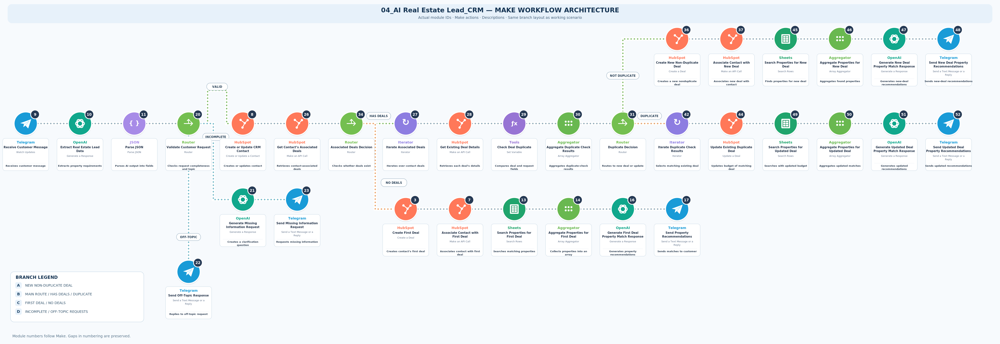
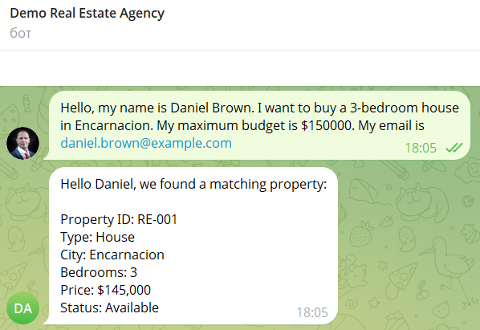
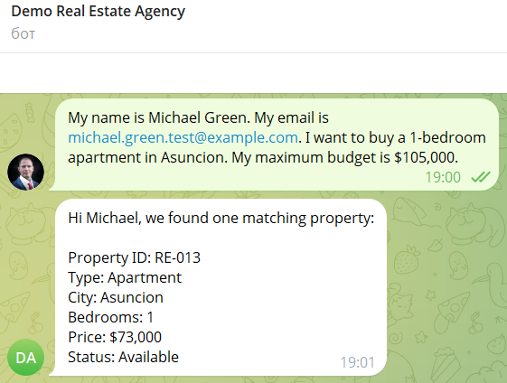
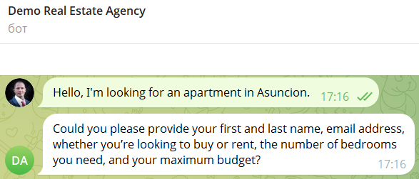
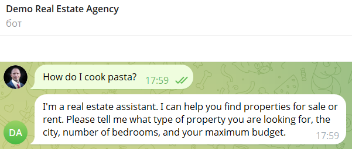

# AI Real Estate Lead Qualification & CRM Automation

**AI-powered Telegram workflow built with Make, OpenAI, HubSpot CRM, and Google Sheets**

**Project type:** Independent portfolio project / Proof of Concept (PoC)  
**Role:** AI Automation Developer  
**Platform:** Make  
**Status:** Functional prototype, tested with synthetic customer and property data  
**Industry:** Real Estate

## System Architecture

The diagram below shows the complete Make automation workflow, including Telegram lead intake, AI-powered data extraction, request validation, HubSpot CRM integration, duplicate deal detection, property matching, and customer responses.

**View the detailed architecture:**
- [English — PNG](github_architecture_en.png)
- [English — SVG (scalable diagram)](github_architecture_en.svg)
- [Russian — SVG (scalable diagram)](github_architecture_ru.svg)
- [Russian — PNG](github_architecture_ru.png)

The diagram reflects the implemented Telegram-based workflow. Email and website integrations are not included in this version.

### Live Make Scenario

View the automation architecture on Make:

[Open the public Make scenario](https://us2.make.com/public/shared-scenario/Z21bQGja9Nk/04-ai-real-estate-lead-crm)

The public page provides a visual overview of the workflow, including its modules and routing logic. It does not provide access to the live automation, connected accounts, or execution credentials.

## 1. Project Overview

This project demonstrates an AI-powered automation workflow for a real estate agency.

Customers submit property requests through a Telegram bot. The automation extracts structured information from natural-language messages, validates customer requirements, manages contacts and deals in HubSpot CRM, identifies duplicate requests, searches a property catalog in Google Sheets, and sends personalized recommendations back to the customer.

The workflow also handles incomplete requests and off-topic messages.

The objective is to demonstrate how AI, CRM systems, and workflow automation can be combined into a practical lead management solution.

## 2. Business Problem

Real estate agencies often receive customer inquiries in unstructured formats.

For example:

"I want to buy a two-bedroom apartment in Miami. My budget is $150,000."

A sales representative would normally need to interpret the message, enter customer information into a CRM, check existing deals, search available properties, and prepare a response.

Manual processing can lead to:

- Repetitive data entry.
- Inconsistent customer information.
- Duplicate CRM deals.
- Delayed responses.
- Additional administrative work.

This project explores how these tasks can be automated through a single Telegram-based workflow.

## 3. Project Objectives

The automation was designed to:

1. Receive customer requests through Telegram.
2. Extract real estate requirements using OpenAI.
3. Convert AI output into structured JSON.
4. Validate requests and identify missing information.
5. Create or update customer contacts in HubSpot.
6. Identify existing and duplicate deals.
7. Create new deals or update existing ones.
8. Search a property catalog based on customer requirements.
9. Generate personalized property recommendations.
10. Return responses to customers through Telegram.

## 4. Technology Stack

| Technology | Purpose |
|---|---|
| Make | Workflow orchestration and automation |
| Telegram Bot | Customer communication channel |
| OpenAI API | Natural-language extraction and response generation |
| JSON | Structured data exchange |
| HubSpot CRM | Contact and deal management |
| Google Sheets | Demonstration property database |
| Routers and Filters | Conditional workflow execution |
| Iterators and Array Aggregators | Processing and combining multiple records |
| HTTP API | Retrieving CRM associations and related data |

## 5. System Architecture

**Customer → Telegram → Make → OpenAI → JSON → Validation Router**

The validation router separates requests into three categories:

**VALID:** The request contains sufficient information for CRM processing.

**INCOMPLETE:** The automation generates a follow-up question requesting missing information.

**OFF-TOPIC:** The bot sends a response explaining the scope of the real estate assistant.

For valid requests, the main workflow continues:

**HubSpot Contact → Associated Deals → Duplicate Detection → Create/Update Deal → Google Sheets Property Search → Array Aggregator → OpenAI Recommendations → Telegram**

### CRM Decision Logic

The workflow supports three business cases:

**Case A — First Deal**

If the contact has no associated deals, the automation creates a new deal and associates it with the contact.

**Case B — New Non-Duplicate Deal**

If the contact has existing deals but the new request is different, the automation creates another deal.

**Case C — Duplicate Deal**

If the request matches an existing deal, the automation updates that deal instead of creating a duplicate.

For this prototype, deal matching is based on the customer contact and the following property requirements:

- Transaction type.
- Property type.
- City.
- Number of bedrooms.

The budget is not part of the duplicate identity. It can be updated without creating a new deal.

## 6. Property Matching

The demonstration property catalog is maintained in Google Sheets.

The automation searches properties using:

- Transaction type.
- Property type.
- City.
- Bedrooms.
- Maximum customer budget.
- Availability status.

Matching records are aggregated and passed to OpenAI, which prepares a readable recommendation message for Telegram.

The demonstration catalog contains 13 synthetic property records.

## 7. Example Workflow

**Example customer request:**

"I want to buy a two-bedroom apartment in Miami. My budget is $150,000."

**Automated processing:**

1. Telegram receives the customer message.
2. OpenAI extracts the requested property criteria.
3. JSON parsing converts the response into structured fields.
4. A router checks whether the request is valid.
5. HubSpot creates or updates the customer contact.
6. The automation retrieves associated deals.
7. Duplicate-checking logic determines the correct deal operation.
8. Google Sheets returns matching available properties.
9. OpenAI generates property recommendations.
10. Telegram delivers the response to the customer.

## 8. Testing and Validation

The prototype was tested using fictional customer data and a synthetic property catalog.

The completed tests covered:

| Test case | Expected behavior | Result |
|---|---|---|
| Valid customer request | Continue to CRM and property search | Passed |
| Incomplete request | Ask the customer for missing information | Passed |
| Off-topic request | Send an appropriate bot response | Passed |
| Contact without existing deals | Create and associate the first deal | Passed |
| Existing contact with a different request | Create a new deal | Passed |
| Duplicate property request | Update the existing deal | Passed |
| Budget change on a duplicate request | Update the budget without creating another deal | Passed |
| Property matching | Return available properties matching the search criteria | Passed |
| Telegram response | Send generated recommendations to the customer | Passed |

**Example validation:** An existing customer request was updated to a maximum budget of $105,000. The workflow updated the existing HubSpot deal and returned a matching demonstration property rather than creating a duplicate deal.

## 9. Technical Challenges and Solutions

### Duplicate Deal Detection

**Challenge:** A returning customer may submit an updated request that should not create another CRM deal.

**Solution:** Retrieve associated deals, iterate through them, compare key property requirements, aggregate comparison results, and route the request to either deal creation or deal update.

### Processing Multiple CRM Records

**Challenge:** One contact may have several associated deals.

**Solution:** Use an Iterator to process deal records and an Array Aggregator to consolidate duplicate-check results before making a decision.

### Handling Different Customer Requests

**Challenge:** Messages may be complete, incomplete, or unrelated to real estate.

**Solution:** Combine AI-based extraction with JSON parsing, validation rules, and conditional Make routes.

### Generating Property Recommendations

**Challenge:** Raw spreadsheet records are not suitable as customer-facing messages.

**Solution:** Filter matching properties, aggregate the results, and use OpenAI to generate a readable response.

## 10. Results and Deliverables

The completed prototype demonstrates:

- An end-to-end Telegram lead-processing workflow.
- AI-based extraction of structured customer requirements.
- Automated HubSpot contact and deal operations.
- Duplicate deal prevention based on defined matching criteria.
- Property matching against a structured catalog.
- AI-generated customer recommendations.
- Conditional handling of incomplete and off-topic requests.

This is a functional demonstration using synthetic data. Production performance, business ROI, and time savings have not been measured.

## 11. Limitations and Future Improvements

The current implementation uses Telegram as its customer communication channel.

Potential future improvements include:

- Email and website lead intake.
- Centralized multichannel processing.
- Additional customer identity verification.
- Expanded property inventory integrations.
- Monitoring, error handling, and operational logging.
- Production security and access controls.
- More extensive automated testing.

These features are future possibilities and are not presented as completed functionality.

## 12. Portfolio Demonstration

The portfolio documentation can include:

- A complete Make workflow screenshot.
- A simplified architecture diagram.
- Screenshots of test interactions in Telegram.
- Example HubSpot contact and deal records.
- An anonymized property catalog.
- A short demonstration video.
- A sanitized Make blueprint or read-only scenario link, if safe to share.

**Security note:** API keys, access tokens, webhook URLs, connection details, and personal customer information must not be published.

## 13. Test Evidence

The automation was tested using synthetic customer data and a demonstration property catalog. Four test scenarios confirm the main workflow functions.

### Test 1 — New Lead and Deal Creation

**Scenario:** Daniel Brown requests a three-bedroom house in Encarnacion with a maximum budget of $150,000.

**Result:** The workflow processes the request, creates or updates the HubSpot contact, creates a new deal, searches the property catalog, and recommends property RE-001 ($145,000) through Telegram.

[View the new HubSpot deal](screenshots/01.2_new_deal_hubspot.png)

### Test 2 — Duplicate Deal Detection and Budget Update

**Scenario:** Michael Green submits an updated request for a one-bedroom apartment in Asuncion with a maximum budget of $105,000.

**Result:** The workflow matches the existing deal, updates its maximum budget, searches the property catalog again, and recommends property RE-013 ($73,000).

- [Updated HubSpot deal](screenshots/02.2_duplicate_updated_hubspot.png)
- [Budget update history — Make integration](screenshots/02.3_hubspot_budget_update_history.png)
- [Original deal creation history](screenshots/02.4_hubspot_deal_creation_history.png)

### Test 3 — Incomplete Request Handling

**Scenario:** A customer requests an apartment in Asuncion without providing all required details.

**Result:** The workflow identifies missing information and asks clarifying questions before proceeding with CRM operations.

### Test 4 — Off-Topic Request Handling

**Scenario:** A customer asks how to cook pasta.

**Result:** The workflow recognizes the unrelated request and explains that the assistant specializes in real estate inquiries.

**Testing notes:** All customer information and property listings are synthetic demonstration data. These tests cover the Telegram-based workflow; email and website channels are not included in this version.

## 14. How to Test the Workflow

The workflow was tested using synthetic customer data and a demonstration property catalog.

The following test cases can be reproduced when the Make scenario and Telegram bot are running and the required integrations are connected.

### Test 1 — New Lead and Deal Creation

Send the following message to the Telegram bot:

> Hello, my name is Daniel Brown. I want to buy a 3-bedroom house in Encarnacion. My maximum budget is $150,000. My email is daniel.brown@example.com.

**Expected results:**
- The AI extracts the customer's requirements.
- HubSpot creates or updates the contact.
- A new deal is created and associated with the contact if no matching deal exists.
- The workflow searches the property catalog.
- The Telegram bot returns matching property recommendations.

### Test 2 — Duplicate Deal and Budget Update

Submit a property request for an existing customer and the same transaction type, property type, city, and number of bedrooms, but with an updated maximum budget.

**Expected results:**
- The workflow identifies the existing deal.
- The maximum budget is updated instead of creating a duplicate deal.
- HubSpot records the property change.
- The Telegram bot returns recommendations based on the updated budget.

### Test 3 — Incomplete Request

Send the following message:

> Hello, I'm looking for an apartment in Asuncion.

**Expected results:**
- The workflow detects missing required information.
- The Telegram bot asks the customer for additional details.
- The incomplete request does not proceed to deal creation.

### Test 4 — Off-Topic Request

Send the following message:

> How do I cook pasta?

**Expected results:**
- The workflow identifies the message as unrelated to real estate.
- The Telegram bot explains its purpose and redirects the conversation toward property inquiries.
- No deal is created for the off-topic request.

### Test Evidence

Screenshots of the completed test cases and corresponding HubSpot records are available in Section 13 — Test Evidence.

**Important:** This is a portfolio demonstration using synthetic data. Live testing requires an active Make scenario, a configured Telegram bot, and authorized access to the connected services.

---

**Project Summary**

This project demonstrates practical skills in AI workflow automation, API integration, JSON processing, CRM automation, conditional routing, duplicate detection, data aggregation, and AI-assisted customer communication.

*Built as an independent portfolio project with synthetic data.*
